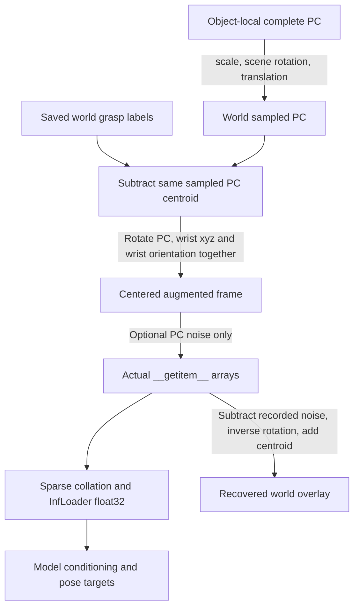

# DexLearn DataLoader preprocessing audit

Date: 2026-10-29. Diagnostic only; no production processing changes.

## 結論

**No verified transform bug / investigate model fitting.** 對 6 筆實際 successful training items，完整呼叫目前 `RobotMultiDexDataset.__init__`、`__getitem__`、production sparse collator 與 `InfLoader`，在無增強、旋轉增強、旋轉加噪聲三種模式，共 18 組／54 stage checks，均能還原原始 BODex grasp labels 與對應點雲。經模型輸入前 float32 cast 後，最大 PC error=4.1474e-8 m、wrist error=7.4506e-9 m、rotation geodesic error=2.8380e-8 rad，遠小於本 task 門檻。

這次與 [前一次 audit](coordinate_pose_audit_2026-10-29.md) 的差別：不是以來源檔案重建畫面代替驗證 loader，而是捕捉實際 DataLoader 呼叫完整 `__getitem__()` 的輸出，再顯示與逆轉那些輸出。未執行 learned network forward、訓練、sampling 或 rollout；不能宣稱完整重播了 50K checkpoint 當時看過的每個 batch。

輸入資料 inventory：4,142 scene files、50,726 records，全部 `succ_flag=true`；其中 **train split 3,334 files／40,814 records**，其餘不屬於這個 train split。Dataset loader 沒有在每次取樣時再依 succ_flag 過濾，而是信任已收集的成功資料；這次 inventory 確認現有 collection 全為 success。這與 task 提到的總量一致，兩個數字不可混用。

## 真正執行的方法

入口：[debug_dataloader_grasp_alignment.py](../scripts/debug_dataloader_grasp_alignment.py)。以既有 `shadowMulti` data YAML 為基礎，明確指定 complete PC、preload=false、right_full metadata、BODex collection、1,024 points、centering=true、voxel=0.005 m。已保存 [diagnostic_config.yaml](../output/dataloader_coordinate_audit/diagnostic_config.yaml)。旋轉與噪聲在診斷 instance 的 flat config 中依 mode 切換；config 檔是切換前的基礎設定，精確 mode/seed/實際角度以 items.json 為準。

完整 constructor 索引真實 train split，沒有用 `__new__` 假造 dataset。train `__getitem__(id)` **不使用 id 選擇固定 record**，而是 random object → random scene file → random grasp record；因此診斷用局部 mock 控制 Python random.choice 與 record randint，並檢查所選路徑確實在 constructor 的 index 中。PC indices 與旋轉角由原本的 NumPy RNG 真正產生，wrapper 僅記錄；seed=123..128，各 mode 使用相同 seed、同筆 record 與 PC indices。每次透過 `DataLoader(dataset, batch_size=1, num_workers=0)` 觸發真實 `__getitem__`，identity collate 暫存原 item。

之後把這 18 個捕捉 item 經真正 `minkowski_collate_fn`，再以另一份 deep copy 經 `InfLoader.get()`。deep copy 是因 collator 會 pop sparse fields；沒有修改原 item 的資料值。使用 CPU 與 num_workers=0 以便記錄 RNG；未檢驗多 worker 的排程或整個 epoch 的抽樣分佈。

模式：

- `no_aug`：只在診斷 instance 關掉 rotation/noise，檢查 deterministic inverse。
- `rotation`：啟用原本 Z rotation augmentation；source default 與現存 experiment config 均為 rotation=true、noise=false。
- `rotation_noise`：額外啟用原本噪聲函式，scale=0.002 m。這是診斷 stress check，**不是聲稱舊訓練啟用噪聲**。記錄實際加上的 noise，包括 float32 cast residual；逆轉時扣掉記錄值，不猜測噪聲。有限採樣的 noise mean 不一定是 0。

production item 沒有回傳 PC indices、augmentation angle/noise；本次由旁路 instrumentation 記錄於 npz。歷史 `.hydra/config.yaml` 曾被 visualize 覆寫，不能據此確證原訓練／推論的全部設定。

## 座標流程與程式位置



| 函式／位置（相對 repo） | 行為與 frame |
| --- | --- |
| `dexlearn/dataset/robot_multidex.py:59` `_init_train_eval` | train.json 篩選物件；依 scene 路徑建立 type availability 與 complete PC index |
| 同檔 `:508` `_load_train_data` | 三階段 `*_global_pose` 為 world wrist xyz+wxyz；`*_joint_pos` 為 rad；先選 source record 再建左右手 fields |
| 同檔 `:395` `_sample_point_cloud` | replacement=True 採 1,024 indices；PC 轉 float32 |
| 同檔 `:460` `_transform_complete_pc` | `(P_raw * scale) @ R_scene.T + t_scene`，輸出 world/m |
| 同檔 `:619` `_apply_pc_centering` | PC 與右手 wrist xyz 減同一 centroid；不改 wrist rotation；固定左 slot 不動 |
| 同檔 `:651` `_apply_rotation_aug` | PC、wrist xyz 右乘 A.T；wrist rotation 左乘 A；A 為隨機 Z rotation |
| 同檔 `:669` `_apply_pc_noise_aug` | 可選 PC Gaussian noise，grasp labels 不加噪聲 |
| 同檔 `:480` `__getitem__` | 執行上述完整流程，最後回傳 PC、coors=PC/voxel、feats=PC |
| `dexlearn/dataset/__init__.py:386` `minkowski_collate_fn` | sparse_collate / sparse_quantize；其餘 fields default_collate，沒有改 pose frame |
| 同檔 `:338` `InfLoader` | floating tensors cast float32 並移動 device；bool left_hand_fixed 也被轉 float32，沒有 pose 算術 |
| `dexlearn/network/backbones/mink_unet.py:12` | sparse network features 用 quantize2original 還原 point feature 對應，再平均做 global conditioning；原始密集 PC 與 pose labels 未被 voxel 化 |
| `dexlearn/network/final_layers/diffusion.py:174` `forward` | stage order pregrasp/grasp/squeeze；最後 stage rotation matrix+translation 組成 `grasp_rt`，RMS normalization；前兩階段 RT 與三階段 joints 另做 loss |
| `dexlearn/utils/RMS.py:28` `Normalization` | `(x-mean)/std` 與 inverse `x*std+mean`；不包含 scene transformation；本次 source trace，未載入 checkpoint stats |
| `dexlearn/task/sample.py:62,530` | test centered prediction 於 export 前加回 pc_centroid，right_full 只處理有效右 slot |
| `dexlearn/utils/logger.py:82` | 原值存 NumPy；不再加 centroid 或 object transform |

模型 head 使用矩陣形式訓練 rotation；58-D 並不是 loader 直接回傳的 target。sample 才輸出 `[right xyz,wxyz,22 joints,left xyz,wxyz,22 joints]`，三階段各 58-D；Bench right_full formatter 取第一個 29-D。

### 公式與 inverse

```text
P_w = (P_raw[indices] * s) @ R_scene.T + t_scene
c = mean(P_w_float32)
P_input = (P_w_float32 - c) @ A.T + noise
w_input = (w_world - c) @ A.T
R_input = A @ R_world

P_recovered = (P_input - recorded_noise) @ A + c
w_recovered = w_input @ A + c
R_recovered = A.T @ R_input
joints_recovered = joints_input
```

Quaternion 來源與 MuJoCo 均為 wxyz；wrist 是 palm/root 的 world pose。Right joint names 逐項比對 source record 與 right_full metadata，再依 MuJoCo model joint names 重排；沒有使用 dummy-arm IK。FK 比較 palm 與五個 distal link origins，並非精確 contact patch 的中心。rotation geodesic 以 SVD 投影浮點 rotation matrix 至 SO(3)，再用 atan2 計算，避免 trace/acos 在接近 0 時放大浮點誤差。

## Actual keys / shapes

下表為單一 item；batch 維度 B=18 在前面新增。完整 dtype 與 post-InfLoader shapes 見 [items.json](../output/dataloader_coordinate_audit/items.json) 和 [batch.json](../output/dataloader_coordinate_audit/batch.json)。

| Key | Item shape | Frame／含義 |
| --- | --- | --- |
| point_clouds | (1024,3) | centered，依 mode 旋轉及加噪聲，m |
| right_hand_trans | (1,3,3) | 1 selected grasp × 3 stages × xyz，centered/augmented |
| right_hand_rot | (1,3,3,3) | 同 frame 的 wrist rotation matrices |
| right_hand_joint | (1,3,22) | metadata order，rad，增強不改 joints |
| left_hand_trans / rot / joint | 與 right 相同 | dataset 原有固定無效 slot：[0,0,-0.5]、identity、zeros；此次驗證三種 mode 均未改動 |
| left_hand_fixed | scalar | true；沒有渲染左手 |
| pc_centroid | (1,3) | 旋轉前 sampled world PC centroid，不是 object origin 或完整 PC mean |
| path / rand_pose_id | string / scalar | 精確 source file 與 source record index |
| grasp_type_id | scalar | 3：right_full |
| target_type_availability / scene_type_counts | (5,) | scene supervision targets |
| coors / feats | (1024,3) | PC/0.005、PC；collation 後 sparse coordinates 為 (M,4)，第一欄是 batch index |

此次 batch M=13,511。驗證 `coors[quantize2original]` 等於 dense input 每點的 `[batch_id,floor(PC/voxel)]`，以及 sparse features 對應 original2quantize 所選 input features。量化會讓同 voxel 多點共享 sparse features；這是設計行為，不是把 wrist labels 平移到 voxel origin。collation 前後密集 PC、wrist、rotation、joint、centroid 完全相同；InfLoader 的 cast 誤差另列。

## 樣本與數值結果

以下均為實際 train split 的 source file；路徑相對 `~/hugs-dataset/BimanBODex_shadow_100k_v1/shadow/right_full/`。完整 scene path、seed、record index、angle、每 stage errors 與 keys 都在 items.json。每筆與來源檔案/scene 精確綁定，不只是同 object。

| Case | Source path | Record index | Z angle（rotation mode） |
| --- | --- | ---: | ---: |
| 0 | `core_bottle_3f41aaa42a237fa3c785f06f424b9d06/tabletop_ur10e/scale023_pose000_0.npy` | 0 | 2.653906604 rad |
| 1 | `core_bottle_ad33ed7da4ef1b1cca18d703b8006093/tabletop_ur10e/scale006_pose005_0.npy` | 0 | -1.368815445 rad |
| 2 | `core_jar_451d7b1633aa8ee741da9a75408092f6/tabletop_ur10e/scale016_pose001_0.npy` | 0 | -0.051938116 rad |
| 3 | `mujoco_LEGO_Star_Wars_Advent_Calendar/tabletop_ur10e/scale008_pose002_0.npy` | 0 | -1.729151610 rad |
| 4 | `mujoco_Xyli_Pure_Xylitol/tabletop_ur10e/scale011_pose002_0.npy` | 0 | -0.208473915 rad |
| 5 | `sem_TableClock_c98d0ef0e3ef0789ad26df5ad8113c0b/tabletop_ur10e/scale006_pose004_0.npy` | 0 | -2.113560338 rad |

以 max absolute element error 比較 translation/joints，rotation 為 geodesic。各 mode 的 PC inverse 最大值均 4.1474e-8 m；pre-centering independent world transform 最大值 3.9611e-8 m。

| Mode | Wrist 最大／中位 (m) | Rotation 最大／中位 (rad) | Joints 最大 (rad) | Palm/distal FK 最大 (m) |
| --- | ---: | ---: | ---: | ---: |
| no_aug | 0.0000e+00 / 0.0000e+00 | 2.5408e-16 / 3.4149e-17 | 0.0000e+00 | 1.5266e-16 |
| rotation | 1.3878e-17 / 6.9389e-18 | 3.5050e-16 / 1.5366e-16 | 0.0000e+00 | 1.5266e-16 |
| rotation_noise | 1.3878e-17 / 6.9389e-18 | 3.5050e-16 / 1.5366e-16 | 0.0000e+00 | 1.5266e-16 |

這些接近 double precision 的 wrist 數字是因來源 labels 與部分旋轉運算使用 float64；真正模型邊界以 **InfLoader float32** 的結果為準：

| Post-InfLoader inverse | 最大 | 中位（每 item 最大值的中位） | 門檻 |
| --- | ---: | ---: | ---: |
| pc_max_m | 4.147313e-08 | 1.436066e-08 | 1e-05 |
| wrist_max_m | 7.450581e-09 | 3.840920e-09 | 1e-05 |
| rotation_max_rad | 2.837909e-08 | 1.704690e-08 | 0.0001 |

## 獨立 held-out export 路徑

使用真實 test-mode constructor + `__getitem__(4102)`，scene 為 `core_camera_98fc1afc8dec9773b10c2418bc64b141/tabletop_ur10e/scale003_pose002_0.npy`。新 diagnostic seed=4321，runtime PC scale=1，centroid 約 (-0.02257187,-0.02868115,0.01512181) m；centered PC mean norm=1.1134e-8 m。

以該 scene 已保存 prediction 做 **oracle control**：先使用本次記錄 centroid center，再呼叫 actual `_decenter_robot_pose` 與 actual `Logger.save_samples`，寫入獨立 export_control。三階段還原 translation error=0，Logger save/load error=0。沒有呼叫 model.sample，也沒有覆寫既有 prediction。

精確 prediction path 與限制：[heldout.json](../output/dataloader_coordinate_audit/heldout.json)。這只能驗證目前 test/export 邏輯和 centroid 傳遞，**不證明歷史 network 輸出當時確實使用同一 centroid**；原 prediction 未儲存當時的 PC indices/centroid。原 experiment config 亦曾被覆寫。

對此同場景，前次 static audit 的 raw prediction object penetration 約 10.432 mm，evaluated 約 10.929 mm；raw 本身已超過 10 mm。前次 10 個刻意選出的 failure cases 中 7 個 raw 已超標、3 個 evaluator pregrasp 外推後才超標。詳見前次報告與 `coordinate_audit_2026-10-29/case_metrics.json`；此次沒有重跑評估，也不將這些 inference failure 歸因於 training preprocessing。

## 信心排序與後續

1. **高信心、有限範圍：目前 training preprocessing 在這 6 筆 × 3 modes 維持 alignment。** 真正 constructor/item/collator/cast 都已執行，全部 stage、22 joints 及 named-joint FK 通過。沒有證據需要修正 training transform。
2. **高信心：目前 test decenter/export 的 oracle roundtrip 正確。** 尚無已驗證的 inference reconstruction bug；對歷史推論的信心受缺少原始 centroid/launch config 限制。
3. **視覺混 frame 的風險已在新 debug view 排除。** Model frame 中參考 mesh/ground truth 也使用相同 rigid transform；world view 中先完整 inverse，再與原始 world GT 疊圖。沒有把 centered PC 配 world wrist。
4. **下一方向是 model fitting／generalization 或抓取階段策略，仍屬待查假說。** 沒有測模型的 train-set fitting，不能把通過 transform audit 等同於證明模型容量不足。可另授權做固定小批 train/held-out 的 prediction 比較，或前次建議的 pregrasp=1/2 paired sensitivity；本次未執行。不需現在重訓或重跑 6,720 筆。

最小 production fix：目前不提出座標修正。若未來需追蹤歷史 inference，建議另案新增 config/PC indices/centroid provenance；不要盲目再加 centroid。此次未改 production code、source data、metadata、checkpoint、predictions、benchmark outputs。診斷只涵蓋 right_full complete-PC；沒有宣稱 partial 或 bimanual 分支已驗證。

## Debug viewer：browser + SSH

本次 viewer 使用 **8088**，保留既有 8080 prediction viewer 與 8087 source-data viewer。已成功初始化並確認 HTTP 200；未做瀏覽器自動點擊測試。

本機：

```bash
ssh -N -L 8088:127.0.0.1:8088 hao-fang@REMOTE_HOST
```

開 `http://localhost:8088`。若本機 port 被占用，改 `-L 18088:127.0.0.1:8088`，開 `http://localhost:18088`。

遠端重啟（目前已在運行，不必重複啟動）：

```bash
cd ~/hugs-workspace/HUGS-DexLearn
export HUGS_DATASET_ROOT="$HOME/hugs-dataset"
OMP_NUM_THREADS=2 .venv/bin/python scripts/debug_dataloader_grasp_alignment.py --serve --port 8088 --case 0 --mode rotation
```

- `Exact training item`：六個精確 scene/source record；畫面列出完整來源及 index。
- `Preprocessing`：no_aug、rotation、rotation_noise；後者是額外診斷模式。
- `Frame`：Model input 顯示保存的 actual `__getitem__` arrays（collation/cast 的微小差異已另驗證），Recovered world 顯示它們的完整 inverse。
- `Stage`：pregrasp / grasp / squeeze。
- 粉紅完整手 + 橘色點：actual returned labels/PC 或其 inverse；青色 wireframe 手 + 青色點：原始 GT，轉進同一個展示 frame；灰色 mesh 同樣轉 frame。可切換 GT overlay。

Viewer 不重新跑 dataset 或 inference，而是讀本次真實 item capture npz；每份包含實際 PC、trans/rot/joints、indices、centroid、augmentation matrix、noise 與獨立 reference。若幾何正確，青色輪廓應與粉紅手重合；noise 模式的 model frame 點雲允許有 intentional 擾動。World inverse 扣除記錄的噪聲後應恢復。

## 重現／測試／完整性

依賴同 workspace 的前次 `scripts/coordinate_audit.py` 幾何工具和 `output/coordinate_audit_2026-10-29/cases.json` manifest（若不存在，先依前次報告執行其 --audit）。沒有安裝或更改套件。**本次使用 DexLearn `.venv/bin/python`**，因 sparse collator 需要此環境中與 Torch 2.11 相符的 MinkowskiEngine；腳本只把 Bench site-packages 附加在搜尋路徑最後以取得 MuJoCo。Bench Python 的 Torch 2.8 無法載入這個 ME extension，所以不要沿用前次的 Bench Python 指令。

```bash
cd ~/hugs-workspace/HUGS-DexLearn
export HUGS_DATASET_ROOT="$HOME/hugs-dataset"
OMP_NUM_THREADS=2 .venv/bin/python scripts/debug_dataloader_grasp_alignment.py --audit
OMP_NUM_THREADS=2 .venv/bin/python -m unittest discover -s tests -p test_dataloader_coordinate_audit.py -v
```

6 個 integration tests 通過：independent scene transform、centering/rotation/noise inverse、全部 stage labels、sparse collation/float32 邊界、named-joint FK negative control、held-out control/input hash。測試讀真實 source 與最新 capture artifacts；先跑 --audit 才是對目前程式的完整回歸。負向控制刻意漏掉 centroid 或顛倒 joint-name mapping，確認檢查能偵測錯位。不是 mock model output 的訓練成功測試。

結果、18 份 npz、[audit.log](../output/dataloader_coordinate_audit/audit.log)、[tests.log](../output/dataloader_coordinate_audit/tests.log)、[inventory.json](../output/dataloader_coordinate_audit/inventory.json)、read_sha256.json 都在專用 `output/dataloader_coordinate_audit/`。audit 結尾重查所有記錄的 source hashes，test 再查一次；涵蓋 collection records、選定 scene/PC/mesh、metadata、split、loader source/config、held-out prediction 與新建 oracle export。不是整個 workspace 的全域 snapshot。checkpoint 沒有讀寫。
