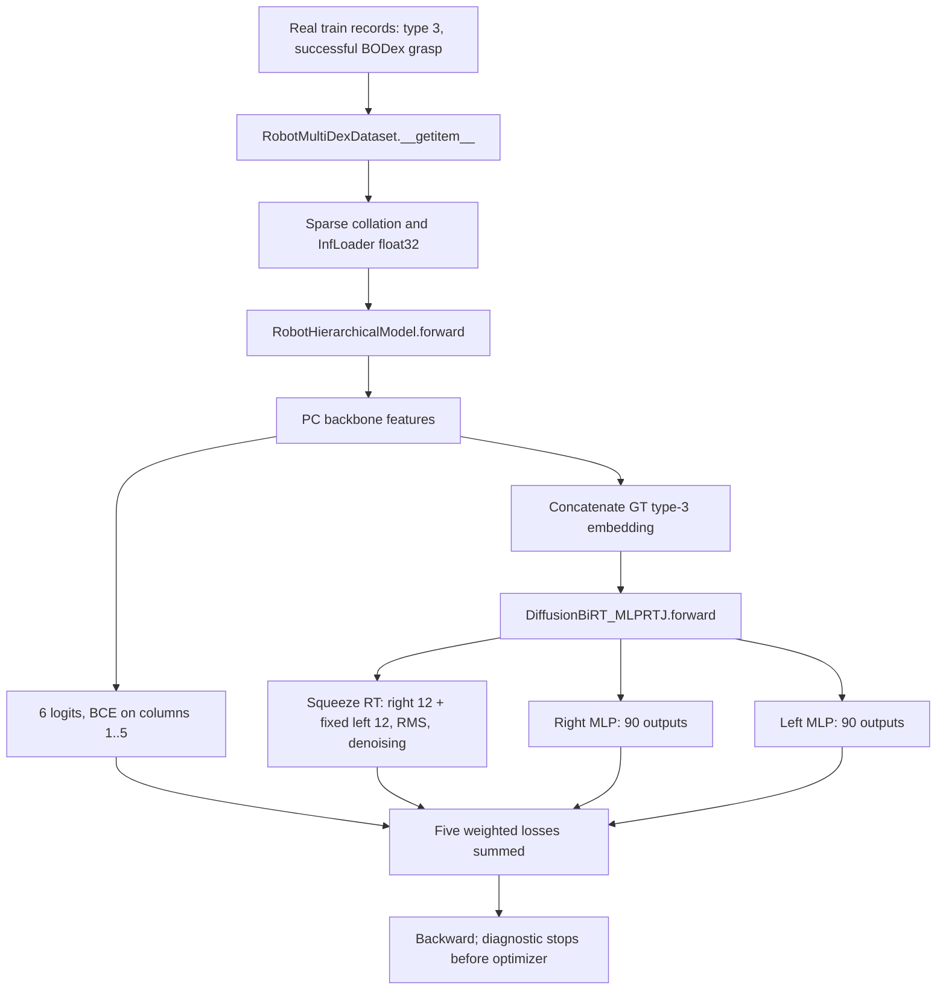

# Right-full grasp-type supervision and loss audit

Date: 2026-10-29. Diagnostic forward/backward only; no optimizer step, retraining, production patch or new sampling/evaluation run.

## 結論

**沒有發現「right_full batch 被拿去監督其他四種 grasp types 的 pose」；有確認「固定左手 slot 未被 mask，仍參與 loss」。** 後者是目前雙手表示法的實際設計行為，對 right-only 任務值得做 ablation，但目前無法認定為造成穿透的 implementation bug。

50K checkpoint、兩筆真實 training items 的實測：labels/conditioning IDs 都是 `[3,3]`，只有 embedding row 3 有直接 loss gradient；diffusion 對兩隻手的 24-D wrist target 算 loss，左手 22 joints 及前兩階段 RT 也受 MLP losses 監督。這些左手 targets 是 dataset 原有固定值，沒有摻入其他 grasp types 的真實或虛構 pose records。

在本次固定小批／固定 diffusion noise 的 50K 檢查中，左手 weighted terms 約占 total **0.4844%**；type BCE 約 **5.69e-10**。不能據此宣稱它們曾經或目前普遍主導 optimization，也不能把這一批結果當成整段訓練的平均。

**歷史 loss 下降情形目前無法還原。** 已找到 `~/dexlearn_100k_train.log`，有 0→50,000 的訓練進度，但沒有任何數值 loss；未找到可識別的 W&B history/TensorBoard events。沒有編造下降曲線，下面的 loss 是新診斷值，不是歷史 logging。

## 四個直接答案

| 問題 | 已驗證答案 | 證據 |
| --- | --- | --- |
| Diffusion 對全部 grasp types 算 loss？ | 否；training 使用 dataset labeled type=3 embedding，一筆資料一個 conditional pose target | `robot_hierarchical.py:145–163`；actual embedding IDs `[3,3]`、只有 row 3 梯度非零 |
| 缺席左手被 masked、fixed 或 penalized？ | **fixed 且 penalized，未 masked**；xyz=[0,0,-0.5]、rotation=I、22 joints=0 | `robot_multidex.py:566` 起；`diffusion.py:190–224`、`naive_diffusion.py:331`；左右 diffusion 各 24/24 非零 output gradients（B=2） |
| 五類 classification 適合單一類型資料？ | 對「只允許產生 right_full」是可用但冗餘的 closed-world availability 目標；不能解讀為其他四種在物理上不可抓 | target 全部 `[0,0,1,0,0]`，其他類被當 negatives，沒有 unknown mask；BCE 不是 pose loss |
| 是否已證明 loss 問題導致低成功率？ | 尚未；確認左 slot 有監督及共享模型耦合，但沒有 causal ablation。既有 high penetration 是 generated pose 現象，不等於已定位 loss bug | 小批 left loss 比例低；先前資料／export／FK audits 通過；本次沒有改 loss 重訓或比較抓取成功率 |

## Source call graph 與 effective configuration

下列 paths 相對 `HUGS-DexLearn/`，行號為本次檢查版本。Git revision/dirty state 保存在 `output/right_full_loss_supervision_audit_2026-10-29/git_state.json`；既有 dirty files 沒有由本次改動。



| Source | 檢查到的行為 |
| --- | --- |
| `dexlearn/config/data/shadowMulti.yaml` | 44 model joints 是 two-hand layout；right_full metadata 由 experiment override 指定；complete PC、centering、Z rotation |
| `dexlearn/dataset/robot_multidex.py:304,323` | availability 依 scene 的 **grasp-type file counts**（不是各 file 中 record 數量）組成；threshold min_count=1、min_ratio=0.05 |
| 同檔 `:508–582` | source `grasp_type` 對應 ID 3；三階段 world wrist 和 22 joints；補固定無效左 slot |
| 同檔 `:619,651` | center/rotate 有效右手；left_hand_fixed=true 時左手不跟著旋轉平移 |
| `dexlearn/dataset/__init__.py:338,386` | InfLoader float32、sparse collation；沒有 loss masking |
| `dexlearn/network/models/robot_hierarchical.py:59–77` | BCEWithLogits 平均全部 B×5 real types；未用 class weights 或 unknown-category mask；column 0 不入 loss |
| 同檔 `:145–163` | backbone→classifier；pose condition 使用 data['grasp_type_id']，不是 classifier argmax/predicted type |
| `dexlearn/network/type_emb.py:6–31` | LearnableTypeCond embedding lookup，disabled=false；本次實際只 lookup ID 3 |
| `dexlearn/network/final_layers/diffusion.py:82–102` | hand_joint_num=44//2=22；wrist_dim=24；每手 MLP output_dim=(22+12)*3-12=90 |
| 同檔 `:174–224` | 最後 stage（squeeze）左右 RT 組成 24-D、RMS normalization、diffusion **未傳 mask**；左右 MLP 各自 loss，再平均 |
| `dexlearn/network/final_layers/diffusion_util/naive_diffusion.py:299–365` | GaussianDiffusion1DMask 名稱雖含 Mask，mask=None 時建立全 1；SmoothL1 element loss / valid-element count |
| `dexlearn/utils/RMS.py:28–43` | `(x-mean)/std`、inverse；train 前 2,000 次 updates，50K checkpoint 的 max_update=0 |
| `dexlearn/task/train.py:654–664` | 只把 result_dict 中、key 存在 loss_weight 的項目加權相加並 backward |
| 同檔 `:685–697` | it=0 skip optimizer.step；之後 AdamW update；本次完全沒有建立或呼叫 optimizer |
| 同檔 `:714–746`、`dexlearn/utils/logger.py:66–72` | log train components 每 10 loop iterations，eval 每 1,000（10 batches）；Logger 只轉發 wandb.log，沒有 scalar file writer |

Diagnostic config 取原 experiment 現存 `.hydra/config.yaml` 的 model/loss 設定，strict 載入 checkpoint；該 config 曾被 visualize 覆寫，**不是恢復的完整歷史 train launch**。本次 constructor override：complete PC、preload=false、right_full、1,024 points；與前次實際 loader audit 相同。batch 改為 2、num_workers=0，GPU forward/backward；Z augmentation 使用實際 RNG 記錄值，PC noise 關閉。`model.train()` 與真實 sparse backbone 均執行；BN running buffers 只在記憶體更新，沒有存回。歷史 batch_size 設定為 256，因此小批 gradient magnitudes/BN 行為不能當成原 batch 的代表值。

`joint_num=44` 不表示 diffusion 直接預測 44 finger joints：diffusion 只處理 **24-D wrist RT**；指關節由兩個 MLP 預測。Loader 回傳的是分離 matrices/trans/joints，並非 58-D target。Sampling 才把三階段各組成 `[xyz,wxyz,22 joints] ×2 =58`，right_full Bench 取原始第一個 29-D。對應前次 [DataLoader audit](dexlearn_dataloader_coordinate_audit.md) 與 [seen evaluation](dexlearn_seen_training_scene_evaluation.md)。

## 實際資料、targets 與 masks

本次 dataset 完整 constructor 索引 **3,334 train scenes**；所有 scene availability targets 的 unique rows 都是 `[0,0,1,0,0]`。兩筆實際 source（record index 都為 0）：

- `/home/hao-fang/hugs-dataset/BimanBODex_shadow_100k_v1/shadow/right_full/core_bottle_3f41aaa42a237fa3c785f06f424b9d06/tabletop_ur10e/scale023_pose000_0.npy`
- `/home/hao-fang/hugs-dataset/BimanBODex_shadow_100k_v1/shadow/right_full/core_bottle_ad33ed7da4ef1b1cca18d703b8006093/tabletop_ur10e/scale006_pose005_0.npy`

來源是 collected successful BODex data，不是自己造零標籤後假裝資料有錯。固定左手 values 來自真正 `__getitem__` 回傳值；additional perturbations 僅用於測試 loss 對這些維度是否直接敏感。

| Tensor | 實際 shape | 含義 |
| --- | --- | --- |
| point_clouds | (2,1024,3) | centered、Z-rotated，float32 |
| grasp_type_id / embedding inputs | (2,) = [3,3] | ground-truth right_full routing |
| target_type_availability | (2,5) | 兩列 [0,0,1,0,0] |
| scene_type_counts | (2,5) | 兩列 [0,0,1,0,0]，file count |
| right/left_hand_trans | (2,1,3,3) | 3 stages；左手各 stage 都 [0,0,-0.5] |
| right/left_hand_rot | (2,1,3,3,3) | matrices；左手各 stage 都 I |
| right/left_hand_joint | (2,1,3,22) | radians；左手各 stage 全 0 |
| left_hand_fixed | (2,) | [1,1]；這個 flag 沒有被本 head 當 loss mask |
| head condition | (2,1152) | backbone 1024 + GT embedding 128 |
| normalized wrist / denoiser pred / v target | (2,24) | right 9 rotation+3 translation，left 9+3 |
| right / left MLP output | 各 (2,90) | pre/grasp xyz 6 + pre/grasp matrix 18 + 三 stage joints 66 |

Classifier 缺席類型被當作 negatives，並非 unknown/unobserved。因 collection 只包含 right_full，這是在學 dataset 的類型支援範圍，不是測試其他四種 grasp 在場景中是否物理可行。此限制對只生成 right_full 的操作目標不構成已確認 bug；若要把輸出解釋為廣義 physical grasp availability，就需要補齊多類資料或明確處理未知標籤。

RMS checkpoint：n=2,000、max_update=0；left mean 精確為 `[I.flatten(),0,0,-0.5]`，left std 每維約 **2.2361e-4**。所以這批 normalized left clean target 為 0；但 v_prediction target 是 `sqrt(alpha)*noise - sqrt(1-alpha)*x`，在 x=0 時仍有 noise 項。**固定 clean pose 不代表 denoising loss 或梯度必為 0。** 此 tiny std 源於 RunningMeanStd 的初始化 floor 和平均公式，不是本次發現的除零。

## 五項實際 active loss 與 reduction

`robotMultiHierar.yaml:82–87` 中以下五項 weights 都是 1；真正 train scalar accumulation 也使用這五項。其餘 `metric_*` 與 `abs_dis_joint*` 只作診斷，不再次加進 total。

```text
L_total = L_type + L_diffusion + L_trans + L_rot + L_joint
L_type = mean_B,5 BCEWithLogits(logits[:,1:], availability)
L_diffusion = sum_B,24 SmoothL1(pred_v,target_v) / (B*24 + 1e-8)
L_trans = 0.5*(mean_B,6 right_translation_error + mean_B,6 left_translation_error)
L_rot   = 0.5*(mean_B,18 right_matrix_error + mean_B,18 left_matrix_error)
L_joint = 0.5*(mean_B,66 right_joint_error + mean_B,66 left_joint_error)
```

上面 MLP error 也為 SmoothL1(beta=1)，不是單純 absolute error。Diffusion config 名稱 `loss_type=l1` 在 `naive_diffusion.py:314` 實際選到 SmoothL1；rotation loss 比 matrix elements，不是 geodesic angle。各組先獨立平均，所以 xyz/rotation/joint 的每 element 權重不同，不能用 raw dimension counts 當 total scalar 比例。

B=2：type denominator=10，diffusion=48；各手 translation=12、matrix=36、joint=132，左右最後各乘 0.5。Mask=None → 每個 denoising target 維度都有效；沒有自動根據 ID 3 移除左手。

**以下都是本次 50K checkpoint 的新診斷值，不是歷史訓練紀錄：**

| Component | Scalar / weighted contribution（weight=1） |
| --- | ---: |
| loss_type | 5.689945737e-10 |
| loss_diffusion | 0.1560630649 |
| loss_trans | 4.962389085e-06 |
| loss_rot | 3.470628872e-05 |
| loss_joint | 0.003149318974 |
| **total** | **0.1592520475** |

| Pose term | Right mean | Left mean | Right contribution to total | Left contribution to total |
| --- | ---: | ---: | ---: | ---: |
| diffusion | 0.31058335 | 0.001542748 | 0.15529168 | 0.00077137398 |
| trans | 9.9170375e-06 | 7.740895e-09 | 4.9585187e-06 | 3.8704475e-09 |
| rot | 6.9401591e-05 | 1.0986316e-08 | 3.4700795e-05 | 5.4931579e-09 |
| joint | 0.006298637 | 8.8265062e-10 | 0.0031493185 | 4.4132531e-10 |

右手 joint absolute-error diagnostic 約 0.09514 rad，左手約 3.10e-5 rad；這不是 loss unit，也不是 grasp success。這一批左手 weighted scalar 合計約 0.00077138，占 total 0.4844%；**scalar 比例不等於歷史累積 gradient/optimization 影響**。

## 梯度與受控 perturbation 證據

所有 head outputs 和檢查的 module parameter gradients 都 finite。每項 loss 分開用 autograd.grad，避免把共享 backbone 的耦合誤判成某個 target 有直接 supervision。

| Loss | 實際非零 output-gradient 維度 | 不直接連接的 outputs |
| --- | --- | --- |
| diffusion | right 24/24、left 24/24（B×12） | type logits、right/left MLP outputs |
| type BCE | logits 的 4 absent categories 各兩筆，共 8/12；ID3 在本批 sigmoid 飽和而數值梯度為 0；ID0 永遠排除 | denoiser、兩個 MLP outputs |
| translation | 每手 12/180，僅前 6 個 outputs ×B | logits、denoiser、其他 MLP維度 |
| rotation | 每手 36/180，僅 18 個 matrix outputs ×B | 同上 |
| joints | 每手 132/180，僅 66 個 joints outputs ×B | 同上 |

Type embedding row-gradient L2：`[0,0,0,0.00412410,0,0]`。這說明此 batch 的 pose loss 路由到 GT type=3；不代表 AdamW weight decay 永遠不改其他 embedding rows，也不表示 classifier 沒有對其他類型負例學習。

Denoiser output-gradient L2：right **0.0611849**，left **0.00566927**。實際參數梯度亦包含 left MLP；其 L2 約 0.00020085，right MLP 約 0.0313704。共享 backbone 存在多 loss 的耦合；這些範數不作跨模型或跨歷史時期比較。

### 固定 prediction 的直接 target 測試

保持真實 denoiser prediction、noise realization、所有右手 target 不變，只對已捕捉的 left v-target 加 0.1：loss **0.1560631 → 0.1583221**；left output gradient 改變最大 0.00208333，right output gradient 的變化精確 **0**。這是直接 loss dependence，不需要依賴模型輸入改變造成的耦合。這個 0.1 是診斷擾動，不是資料中觀察到的錯誤。

固定 actual left MLP prediction，分別修改 actual left targets：

| 診斷擾動 | 該 left metric before → after | Total loss change |
| --- | --- | ---: |
| 前兩 stage translation +0.1 m | 7.740895e-09 → 0.0050007589 | 0.0025003755 |
| 前兩 stage rotation 左乘 0.1 rad Z rotation | 1.0986316e-08 → 0.0011102298 | 0.00055510941 |
| 三 stage joints +0.1 rad | 8.8265062e-10 → 0.0049998718 | 0.0024999355 |

這些測試確認左手 RT/joints 全有直接 penalty。沒有更改來源資料或進行 optimizer update。

### Mask ablation 的 denominator 注意事項

只在保存的 element losses 上做數學比較（未訓練任何 masked model）：目前左右平均 0.1560631；只取 right 且用 right valid denominator 平均是 0.3105834；只把 left 設零、仍除原 denominator 則為 0.1552917。**加 mask 同時改 denominator 會把右手每 element 權重加倍**，所以未來 ablation 必須明確控制 normalization，不能把兩個實驗直接叫做只差 mask。

## Training、sampling 與 selection 的區別

Training 使用 GT type embedding，只 forward 一個 `(B,24)` denoising target；沒有 class-conditioned 的五倍 target 展開。Sampling 才在 `robot_hierarchical.py:106–143` 對五個 real types 展開 features、每類生成 n 個候選、依 availability mask 排除不允許的類型；前次 seen experiment 中實際保留 type3 top10。

本 head 的 `diffusion.py:228–240` 在 sampling 呼叫 `diffusion.sample(cond=...)` 仍不傳 mask。`naive_diffusion.py:367–450` 的 initial log density、ODE dynamics 和 divergence 使用全部 24 dimensions。**因此 inference ranking score 可能包含未用到的 left latent 表現**；這是值得另案檢驗的 selection 設計疑慮，不是本次已量化的成功率根因。Type log-prior 加到 candidate score 與 BCE training loss 也是兩件事；同 scene 的同一 type score prior 相同，不改該 type 內部的相對 ranking。

`proper_svd` 在 sample 重建 rotation；Logger 保存 58-D，right_full formatter 只取 29-D 有效右手。左 slot 的 export 丟棄不會逆向移除 training 時左 slot 的 loss。相關還原/FK 已在 [seen report](dexlearn_seen_training_scene_evaluation.md) 對真實生成結果驗證，本次不重新 sampling。

## 50K 歷史 loss 搜尋結果

原始來源：`/home/hao-fang/dexlearn_100k_train.log`（約 632 KB，mtime 2026-10-28）。其訓練分佈檔輸出路徑明確指向本 experiment；constructor 訊息顯示 3,334 train、808 eval scene files；進度到 50,000/50,000，約 19:16。已提取 **10,003 筆 progress records** 到 `historical_progress_only.csv`。**進度不是 loss。**

| 檢查來源 | 結果 |
| --- | --- |
| 原始 train console log | 有完整 loop progress；0 筆 loss metric；無 `grad is nan!` 訊息／traceback，但不能藉此估計未記錄的 loss nonfinite rate |
| experiment main.log | 後來的 viewer/websocket 訊息，不是訓練 loss |
| repo output、home/workspace/tmp 的 W&B history / TensorBoard event filenames | 未找到對應 history/event 檔；精確 scoped search 資訊見 historical_loss_search.json |
| local wandb / ~/.cache/wandb | 搜尋狀態與候選檔名保存於 search JSON；未取得 numeric history |
| tmux session | pane history_size=0，沒有可恢復的舊 loss scrollback |
| 5K..50K 的 10 個 checkpoints | 50K keys 為 model、optimizer、iter；不是逐 step scalar history，不能由 weights 還原曲線 |
| 現存 config / Logger / train source | wandb.mode=disabled；Logger.log 僅呼叫 wandb.log，train loop 不把 losses 印到 console 或寫 CSV/TensorBoard。這支持「未持久保存 metrics」的解釋，但原完整 train launch 被覆寫，不能據此單獨證明原 run 每一設定 |

Historical `train/loss_diffusion`, `train/loss_type`, `train/loss_trans`, `train/loss_rot`, `train/loss_joint` 與 eval counterparts：**可恢復樣本數均為 0**。初期/中期/末期平均、median、下降百分比、plateau、train/eval divergence 均 **unknown**；所有 step 範圍缺 scalar data。`historical_loss_records.csv` 只有 schema header，沒有偽造 0 值；沒有產生假的 loss-versus-step 圖。

即使當時開啟 logging，檢查到的程式只記錄 result_dict components，不直接記錄 `L_total`；有 components 與當時 weights 才能推導 total。logger 用 zero-based loop index `it`，checkpoint iter 是 `it+1`；當前 train code 的 it=0 不做 optimizer.step。因此 progress/ckpt iteration 不能毫無區分地當成 optimizer-update count。

Validation path 是 `create_train_dataloader`→dataset mode eval→`test.json`（`robot_multidex.py:59–61`），不是 train-scene performance；loader eval 不做 train rotation augmentation，雖使用同 loss 定義，資料分佈不同。本次沒有新增 validation curve。

另外，現存 `training_data_distribution.json` 顯示全 0，**不能當成沒有訓練資料的證據**：`dataset/__init__.py:76–111` 會跳過沒有 `get_distribution_analysis` 的 dataset component，RobotMultiDexDataset 正是此情況；真實 constructor 與 console 都顯示非零索引。本次沒有修正這個 reporting 缺口。

若之後找到外部 W&B run/export，可再按 run identity 與 step 對齊；目前沒有啟用 tracking、上傳資料或新建訓練 run。新 diagnostic forward 絕不替代歷史下降情形。

## 分類與最小後續方案

**已確認實作行為，尚未確認 causal bug：** fixed inactive left slot 被監督；absent types 在 availability BCE 被當 negatives。對目前 right_full-only conditional training，沒有發現 fake other-type pose targets 或錯誤 predicted-type routing。

優先順序：

1. **恢復或補足可觀測性。** 若有既有外部 history，讀回原 run；對未來另行授權的 training 增加獨立 append-only scalar CSV（step、raw components、weighted total、validation split、config hash），避免 disabled W&B 導致無歷史曲線。本次不改 Logger。
2. **檢查 inference selection score。** 在另行授權的小實驗中保存 right_full 全部 proposals 的 score、左右 latent 分項與 static contact，檢驗 top-k 與 penetration 的關聯；不要先假定 diffusion likelihood 等同 physical grasp quality。
3. **left-slot masking／right-only model ablation。** 若要驗證其 optimizer/capacity 影響，提出獨立 patch：type-aware wrist mask + MLP inactive-side mask，明訂 denominator/有效維度權重，保持 bimanual 行為；或獨立 12-D wrist/22-joint architecture。後者不與舊 24-D checkpoint 直接相容。兩者都需要新的受控訓練才能推論因果，本次未實施。
4. **type-loss ablation。** 單一類模型可比較固定 right_full conditioning、停用 availability loss 的小型訓練，但本批 type loss 已極小，不優先把它當成主因。若要廣義多類 physical availability，應改資料標註／unknown-category semantics，而不是只改 loss weight。

對舊 checkpoint 的含義：它確實學習兩個 slot，包括固定左 slot；不能在不驗證 sampling dynamics/score 的情況下刪掉 half dimensions 或改 mask 然後宣稱已修好。沒有依據現在重跑全部 MuJoCo benchmark 或直接重訓。

## 重現、測試與完整性

```bash
cd ~/hugs-workspace/HUGS-DexLearn
export HUGS_DATASET_ROOT="$HOME/hugs-dataset"
OMP_NUM_THREADS=2 .venv/bin/python scripts/audit_right_full_loss.py
.venv/bin/python scripts/audit_right_full_loss_history.py
OMP_NUM_THREADS=2 .venv/bin/python -m unittest discover -s tests -p test_right_full_loss_audit.py -v
```

使用現有 DexLearn venv（Torch/MinkowskiEngine 匹配），診斷資料擷取沿用 `scripts/debug_dataloader_grasp_alignment.py` 和前次 `coordinate_audit` cases manifest，附加既有 Bench site-packages 以提供其 MuJoCo 工具。未安裝套件。

腳本呼叫真實 dataset、完整 backbone/model.train forward，固定 torch seed=20261029；一次正常 backward、若干 retain-graph autograd output checks 與固定 prediction 的 loss 計算。沒有 optimizer 建構或 step；不是 training restart。RMS max_update=0，checkpoint/source files 保留。

**6 tests passed**：actual labels/fixed left、BCE negatives/0_any excluded、雙手 denoising 梯度、MLP targets/reductions、從 actual train.py AST 執行 scalar accumulation、protected hashes/history absence。檢查了正常 loss branches；未執行 alternate heads、epsilon/sample prediction、masked-training branch、partial/bimanual datasets、其他 checkpoints 的 loss curves。PyTorch forward hook 對被直接呼叫 `.forward()` 的 head 或覆寫 `__call__` 的 RMS 不會觸發，腳本因此從真正 diffusion-call inputs 擷取 condition，並逐值驗證 RMS 公式，而非捏造 hook 結果。

Artifacts：[loss_audit.json](../output/right_full_loss_supervision_audit_2026-10-29/loss_audit.json)、[diagnostic.log](../output/right_full_loss_supervision_audit_2026-10-29/diagnostic.log)、[tests.log](../output/right_full_loss_supervision_audit_2026-10-29/tests.log)、real_batch_and_outputs.npz、effective_model_loss.yaml、[historical_loss_search.json](../output/right_full_loss_supervision_audit_2026-10-29/historical_loss_search.json)、historical_loss_records.csv、historical_progress_only.csv。

Checkpoint SHA-256：`b4d6a241ace57e4ca4f265fd6733cd72d0094645970451b91189b15d73f60ff6`；本次直接讀取的 protected source/config/checkpoint hashes 前後一致，並重查前次保護清單的 **36,744 paths 全部未變**（原 predictions、baseline/evaluation npy、checkpoint/metadata、選定 training sources）。沒有覆寫任何既有報告或生產實驗資料。
