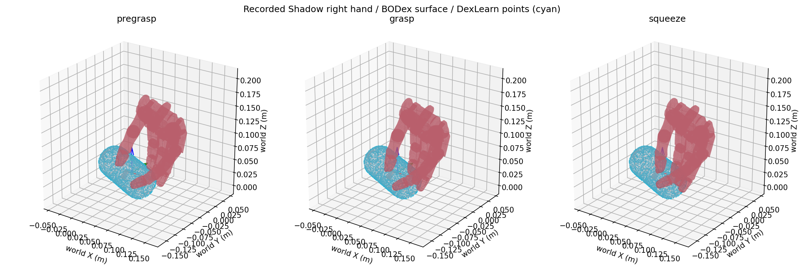

# BODex → DexGraspBench → DexLearn geometric alignment

Validation date: 2026-10-28. Scope: one successful Shadow `3_right_full` grasp, all three recorded stages. No dataset, grasp label, model, training configuration, or installed dependency was changed.

## Result

For the inspected record, the point cloud and object mesh use the same normalized object frame and reconstruct the same world frame. Recorded wrist poses match independently recomputed benchmark MuJoCo FK. DexLearn centering and Z augmentation preserve object points in the active palm frame. The synthetic left hand remains a fixed placeholder by design.

These conclusions apply to this record; this is not a dataset-wide validation or a new physical grasp-success evaluation. No arbitrary pass/fail distance threshold was introduced.

- Scene: `core_bottle_46910c75d17ef8554c6e2707eea5c15e/tabletop_ur10e/scale008_pose005_0`
- Grouped successful record index: **0**, `succ_flag=True`.
- Original BODex candidate / benchmark file: **14** / `14_grasp.npy`.
- Grouped indices are not original candidate indices: collection uses directory enumeration. The script establishes provenance by exact matching of all three stage qpos arrays.
- Point cloud: 4,096 points stored as **float16**; training check samples 1,024 points with replacement, seed 0.
- Actual object scale: **[0.081, 0.081, 0.081]**, read from the scene, not inferred from `scale008` in the filename.
- Object world translation: **[0.0134272063, -0.0488699609, 0.0328324294] m**.
- Object quaternion, **wxyz**: **[0.5632464436, 0.3916514580, -0.6404101474, 0.3453077211]**.

Artifacts:

- [Runnable inspector](../tests/visualize_grasp_alignment.py)
- [Full numerical JSON, provenance and input SHA-256 hashes](grasp_pointcloud_alignment_metrics.json)
- [Three-stage world-frame preview](grasp_pointcloud_alignment_preview.png)
- [Analytical metric and training-transform checks](../tests/test_grasp_alignment_metrics.py)



## Transformation chain and source implementations

Paths below are relative to `~/hugs-workspace`. Line numbers refer to the inspected source state.

| Stage | Implementation | Actual transformation / contract |
|---|---|---|
| BODex scene paths | `HUGS-BODex/src/curobo/util_file.py:262`, `util/human_prior_seed.py:433` | Resolve scene-relative mesh paths; read scene object scale and pose. |
| BODex world geometry | `HUGS-BODex/src/curobo/util/world_cfg_generator.py:61` | `scenecfg2worldcfg` copies `file_path`, `urdf_path`, scale and pose into the world mesh record. |
| BODex mesh coordinates | `HUGS-BODex/src/curobo/geom/types.py:510`, `:163` | Multiply local mesh vertices by scale; pose matrix uses translation and real-first quaternion. |
| BODex saved hand stages | `HUGS-BODex/src/task/synthesis.py:2502` | Store pregrasp/grasp solutions. For a root-pose hand, squeeze keeps grasp root pose and uses `2*q_grasp - q_pregrasp` for finger joints. |
| Benchmark formatting | `HUGS-DexGraspBench/src/task/convert_format.py:515` | Copy candidate stages directly to `*_qpos`; object pose is copied, scale uses scene scale[0]. The selected scene is isotropic. |
| Benchmark geometry | `HUGS-DexGraspBench/src/util/hand_util.py:163`, `:253` | Hand comes from `assets/hand/shadow/right_hand_v2.xml`; object collision geometry comes from `processed_data/<object>/urdf/meshes/*.obj`, scaled once. |
| Benchmark joint order | `HUGS-DexGraspBench/src/task/eval_func/base.py:101` | Reorder named hand joints into MuJoCo order before FK/evaluation. |
| Optional evaluation adjustments | `HUGS-DexGraspBench/src/task/eval_func/base.py:301`, `:321`, `:495` | Optional world Z offset and stage extrapolation are supported; adjusted qpos are saved back in input joint order. They were no-ops for this record. |
| Benchmark pose reset / FK | `HUGS-DexGraspBench/src/util/hand_util.py:599` | Set hand and object qpos, set mocap position/wxyz quaternion, reset keyframe, then `mj_forward`. No simulation stepping is needed for inspection. |
| Benchmark stored wrist frame | `HUGS-DexGraspBench/src/task/eval_func/base.py:723` | Reset each recorded stage; read world `xpos`/`xquat` of `child-rh_palm`. Store 7D wrist pose and 22 finger joint values. |
| Success collection | `HUGS-DexGraspBench/src/task/eval_func/base.py:852`, `src/task/data_collect.py:10` | Collect success-linked evaluation records, stack arrays; strip keys containing `obj` but preserve scene reference. |
| Training dataset assembly | `HUGS-DexGraspBench/script/concatenate_dataset.py` | Copy grouped success files and write joint/wrist metadata; no geometric transform. |
| DexLearn object reconstruction | `HUGS-DexLearn/dexlearn/dataset/robot_multidex.py:395`, `:400`, `:408`, `:420`, `:460`, `:557` | Sample local points, obtain scale and wxyz object pose, apply scale → rotation → translation. |
| DexLearn hand reconstruction | `HUGS-DexLearn/dexlearn/dataset/robot_multidex.py:564`, `dexlearn/utils/rot.py:9` | Use stored wrist world translation and real-first quaternion, without applying the object transform again. |
| Training centering / rotation | `HUGS-DexLearn/dexlearn/dataset/robot_multidex.py:619`, `:651` | Subtract sampled cloud centroid from cloud and active hand translation; apply the same Z rotation to cloud, active translation and active orientation. |

For row-vector points, the object transform is:

```text
p_world = (p_object * scale_xyz) @ R_object.T + t_object
v_world = (v_mesh   * scale_xyz) @ R_object.T + t_object
```

For hand-local points, the stored wrist pose is a world-frame palm transform:

```text
v_hand_world = v_hand_palm @ R_palm.T + t_palm
```

The inspector instead uses the actual benchmark MJCF and MuJoCo FK, reordering joints by name. Compiled mesh vertices already include asset scale; applying `geom_xmat` and `geom_xpos` produces world vertices. The XML specifies radians and hand mesh scale 0.001 for millimeter mesh assets. No extra manual hand rescaling or wrist offset is applied. The selected hand's root and palm translations agree in the recorded pose; the script verifies the palm rather than assuming every robot has this relationship.

The visualization shows the BODex `mesh/simplified.obj` surface and offers a separate toggle for the benchmark convex pieces. These representations should not be conflated. The world axes are fixed at the original origin; camera framing does not move geometry. No centering or random augmentation is applied to the displayed scene.

## Provenance and pose checks

The original BODex saved `world_cfg` and the benchmark evaluation record both have exactly the same object pose/scale as the current scene config. The original saved mesh reference is `object/DGN_2k/processed_data/<object>/mesh/simplified.obj`.

All stages have:

- BODex → formatted qpos maximum absolute difference: **0**.
- Formatted → collected successful qpos maximum absolute difference: **0**.
- Scene references and named joint ordering: match.
- Recomputed MuJoCo palm translation vs stored global translation: **0 m**.
- Recomputed palm rotation matrix vs stored quaternion matrix: at most **5.55e-16** elementwise.
- Stored qpos fingers vs stored joint targets: **0**.

The saved benchmark configs in `output/single_hand_demo_v2_right_full_shadow/log/eval/*/.hydra/config.yaml` specify `grasp_global_z_offset: 0`, `pregrasp_extrapolate_ratio: 1.0`, and `squeeze_extrapolate_ratio: 1.0`. This configuration evidence is supported by the exact array comparison above. Simulation temporarily moves bodies while testing success, but exported poses are recomputed after resetting each recorded stage, not copied from the final displaced simulation state.

## Numerical geometry comparison

All 4,096 stored points were queried against mesh triangles, not nearest vertices.

| Metric, meters | BODex simplified surface | Benchmark convex-piece surfaces |
|---|---:|---:|
| Mean distance | 0.00000481998 | 0.0000950363 |
| RMS distance | 0.00000600532 | 0.000113482 |
| Median | 0.00000421294 | 0.0000912265 |
| 95th percentile | 0.0000114361 | 0.000167929 |
| Maximum | 0.0000197331 | 0.000719164 |

The benchmark quantity is the minimum distance to all individual compiled convex-piece surfaces, not a signed distance to the Boolean-union boundary. It can include internal piece surfaces. No tiny object piece was skipped for this object.

DexLearn's float32 scene conversion differs from an independent float64 wxyz conversion by at most **1.391e-8 m**. The cloud's local point-to-surface mean is **5.951e-5 normalized units**, consistent with the physical mean after multiplication by 0.081. Float16 storage gives a maximum local half-ULP coordinate-rounding envelope of approximately **2.422e-5 m** in Euclidean norm after scene scaling. The measured surface discrepancies are compatible with this precision, but the original point-cloud preprocessing/sampling code is not present in these three repositories, so its exact creation algorithm is not independently established.

Distance-query numerical detail: trimesh uses absolute tolerances. Direct tiny-world-triangle queries initially produced unstable outliers under scale changes. The inspector translates and scales **both** query points and mesh together to a common characteristic length solely inside the distance calculation, then converts distances back to meters. This preserves Euclidean distances mathematically and changes neither stored nor displayed geometry. Analytical meter-unit/rigid-transform tests and an independently shifted-cloud negative control pass.

World bounds, meters:

| Geometry | Minimum XYZ | Maximum XYZ |
|---|---|---|
| Point cloud | [-0.048951786, -0.108288392, -0.000218503] | [0.086444132, -0.001027826, 0.059546780] |
| BODex surface | [-0.049028737, -0.109056587, -0.000266092] | [0.086518960, -0.000879206, 0.065249097] |
| Benchmark pieces | [-0.049091553, -0.109281809, -0.000171275] | [0.086486180, -0.000981707, 0.066073804] |

The largest point-cloud bounding-box deficit is the upper Z bound: **0.00570232 m**. A separately generated 4,096-point, area-weighted mesh sample at seed 0 has **0.00538675 m** upper-Z deficit. Together with the very small point-to-surface distances, this supports finite sampling of small/extreme mesh features as an explanation; bounding-box equality is not required for surface samples. This one experiment does not prove complete surface coverage. Benchmark-vs-BODex bounds differ by up to **0.000824707 m**, consistent with distinct convex decomposition geometry; no alignment correction was applied to remove it.

## Training-frame validation

The script calls the actual DexLearn `_sample_point_cloud`, `_transform_complete_pc`, `_apply_pc_centering`, and `_apply_rotation_aug` methods. It uses recorded poses/joints from the selected grasp and the existing right-only sentinel contract. The sampled-cloud centroid is:

```text
[0.0218980517, -0.0498228520, 0.0298928842] m
```

For a reproducible 37-degree Z rotation, supplied to the existing augmentation RNG call:

```text
p_train = (p_world - centroid) @ Rz.T
t_train = (t_world - centroid) @ Rz.T
R_train = Rz @ R_world
```

Cloud/hand centering and rotation match these formulas exactly in the computed checks. For every sampled point and each stage, compare the palm-frame coordinates:

```text
(p_world - t_world) @ R_world
(p_train - t_train) @ R_train
```

Maximum differences are **[1.830e-9, 1.812e-9, 1.812e-9] m** for pregrasp/grasp/squeeze. Right joint targets are unchanged.

For `right_full`, `left_hand_fixed=True`, translation is `[0, 0, -0.5]`, rotation is identity and left joints are zero. The dataset deliberately skips both centering and rotation for that synthetic inactive hand. The script verifies that it remains unchanged. It is a placeholder in the model data contract, not a second physically transformed hand; imposing the active-hand rigid transform on it would contradict the implementation.

## Reproduce

Use the **existing benchmark virtual environment**: it already contains MuJoCo, rtree, Viser, and the dependencies needed to import DexLearn's dataset transformations. The DexLearn environment lacks MuJoCo/rtree; no package installation was needed.

From `~/hugs-workspace/HUGS-DexLearn`:

```bash
# All three stages, world axes, cloud, surface, optional collision-piece toggle.
../HUGS-DexGraspBench/.venv/bin/python tests/visualize_grasp_alignment.py
# Open http://127.0.0.1:8087 ; Ctrl-C stops the server.

# Numerical JSON and static overview, without starting a viewer.
../HUGS-DexGraspBench/.venv/bin/python tests/visualize_grasp_alignment.py \
  --headless \
  --report docs/grasp_pointcloud_alignment_metrics.json \
  --snapshot docs/grasp_pointcloud_alignment_preview.png

# Another successful record in the same grouped scene.
../HUGS-DexGraspBench/.venv/bin/python tests/visualize_grasp_alignment.py \
  --grasp-index 1 --stage squeeze --report output/grasp_alignment/record_1.json

# Inspect another scene, preserving its actual scene transform.
../HUGS-DexGraspBench/.venv/bin/python tests/visualize_grasp_alignment.py \
  --scene-id core_camera_9e91f482b829c4d1e9fff7dfdebc774b/tabletop_ur10e/scale011_pose004_0 \
  --grasp-index 0 --report output/grasp_alignment/camera.json

# Analytical validation of metric units and training-frame invariance.
../HUGS-DexGraspBench/.venv/bin/python -m unittest discover \
  -s tests -p test_grasp_alignment_metrics.py -v
```

`--dataset-root`, `--bench-repo`, `--bench-run`, and `--bodex-grasp-root` override source locations. The current dataset contract is specifically the `BimanBODex_single_hand_demo_v2/shadow/right_full` tree. Missing provenance is reported explicitly; anisotropic scaling raises an error because the benchmark conversion uses a scalar scale. The script does not choose a compensating scale or transform.

Completed checks: headless real-record inspection; all three hand-stage meshes generated; Viser server and scene creation smoke test (`--viewer-seconds 3`); static preview visually inspected; two analytical tests passed. The browser's interactive stage switch has not been manually exercised. The smoke-test viewer was stopped; use the command above to start a persistent local viewer.
